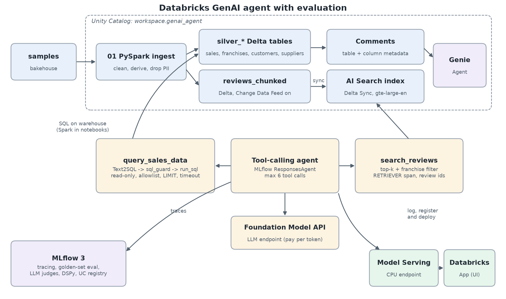

# Databricks GenAI agent with evaluation

A tool-calling GenAI agent on Databricks that answers business questions over bakery sales tables and customer reviews. It is evaluated in MLflow 3 against a golden set with computed ground truth, and its Text2SQL prompt is optimised with DSPy.

Built on Databricks Free Edition (serverless) with Unity Catalog, PySpark, Databricks AI Search (formerly Vector Search), Model Serving, Databricks Apps, MLflow 3 and DSPy.



## What it does

Ask *"Which franchise had the highest revenue, and what are customers complaining about there?"* and the agent:

1. calls `query_sales_data`, which writes SQL from the question (Text2SQL), checks it with a strict guard (single read-only `SELECT`, table allowlist, enforced `LIMIT`, timeout) and runs it;
2. calls `search_reviews` with the franchise's `franchise_id` as a metadata filter over an AI Search index of review chunks;
3. answers from the tool results only, citing review ids and showing the SQL it ran.

Every step is traced in MLflow, including a `RETRIEVER` span for the search, so the answer can be judged for groundedness.

## Results

> **Status: not yet run on Databricks.** The code, tests and notebooks are complete, but this repository was built in an environment with no Databricks workspace access. No numbers are reported until they come from real runs. Each number will be filled in by `notebooks/10_results_report.py` together with its MLflow run ID.

| Variant | Test pass rate | SQL result match | Groundedness | Median latency | MLflow run ID |
|---|---|---|---|---|---|
| Baseline agent | not run yet | not run yet | not run yet | not run yet | |
| DSPy-optimised agent | not run yet | not run yet | not run yet | not run yet | |
| Genie Agent (SQL questions only) | n/a | not run yet | n/a | not run yet | |

**Pass** means the Correctness judge says yes, the Safety judge says yes and, for questions with a reference SQL, the agent's SQL returned exactly the reference result. All numbers are on the held-out **test** split. The Genie row uses only the SQL questions, because Genie does not search documents; the agent rows for that comparison are recomputed on the same subset (see `evals/results/genie_comparison.csv`).

## Screenshots

To be added after deployment (`docs/images/`): the app, an MLflow trace with tool spans, and the evaluation results view.

## How to run it on Databricks Free Edition

1. Sign up for Databricks Free Edition and note the workspace URL.
2. In the workspace, create a Git folder from this repository (Workspace, Create, Git folder).
3. Open `notebooks/00_setup.py` on serverless compute and run it. It creates `workspace.genai_agent`, picks the LLM, judge and embedding endpoints available to you, finds the SQL warehouse and writes `config/runtime.yaml`.
4. Run `01_ingest.py` (PySpark to Delta), `02_ai_search_index.py` (AI Search endpoint and Delta Sync index) and `03_tools_smoke_test.py` (schema context, tools and a first traced agent run).
5. Run `04_agent_log_register.py` (log and register in Unity Catalog) and `05_deploy_serving.py` (Model Serving endpoint plus a 5-question REST smoke test).
6. Run `06_build_golden_set.py`, read the printed review facts, then commit `evals/golden_set.jsonl`.
7. Run `07_evaluate_baseline.py`, then `08_dspy_optimise.py` (optimises, registers the `optimised` version and re-runs the same evaluation).
8. Create a Genie Agent over the `silver_*` tables (click steps in [docs/DESIGN.md](docs/DESIGN.md#genie-setup)), then run `09_genie_benchmark.py` with its ID.
9. Deploy the app: `databricks bundle deploy` then `databricks bundle run bakehouse_app`. Free Edition apps stop after 24 hours; rerun the second command to restart.
10. Run `10_results_report.py` and copy its table into this README.

Alternatively, `databricks bundle run build_and_evaluate` runs notebooks 00 to 07 as one serverless job.

## Repository layout

```
src/agent/      config, SQL guard, tools, prompts, LLM client, ResponsesAgent, MLflow setup
src/pipeline/   PySpark transforms and review chunking
src/evals/      golden set specs and builder, scorers, evaluation runner, DSPy module, Genie client
notebooks/      00 to 10, Databricks source format, run in order
app/            Streamlit Databricks App
tests/          pytest (no Databricks needed); a local Spark test runs when Java and PySpark exist
databricks.yml  Declarative Automation Bundle: the build job and the app
```

## Design decisions and trade-offs

See [docs/DESIGN.md](docs/DESIGN.md). In short:

* **Tool calling rather than a fixed pipeline**, because questions vary between pure SQL, pure retrieval and hybrid.
* **Text2SQL is a tool with its own prompt**, so DSPy can optimise that prompt in isolation with an execution-accuracy metric.
* **Ground truth is computed** by running reference SQL, so expected answers cannot drift from the data.
* **Guarded, read-only SQL** with an allowlist, enforced limits and a timeout; personal data is dropped at ingestion.

A 20-minute guided tour is in [docs/WALKTHROUGH.md](docs/WALKTHROUGH.md).

## Testing

```bash
pip install -r requirements-dev.txt
ruff check src tests app && pytest -q
```

The unit tests (about 225, no Databricks connection needed) cover:

* the SQL guard: over 45 cases, including injection attempts, forbidden tables in subqueries, `IDENTIFIER()` and path-based tables, and limit rewriting;
* the tools and the agent loop with mocked clients: tool budget, parallel tool calls, bad or non-numeric arguments, failing tools (returned to the LLM as structured errors rather than ending the conversation) and citation parsing;
* the SQL executors (Spark timeouts and interrupts, chunked SQL warehouse results), the LLM client's per-request token refresh and the MLflow setup;
* settings loading, prompt variants and review chunking;
* the golden set: every question template, SQL escaping of values picked from the data, ground-truth building with mocked queries, and parsing of the LLM-extracted review facts;
* the evaluation: scorers against real local MLflow traces, the combined groundedness verdict, the per-question summary and pass definition, and a full `run_evaluation` on a local MLflow store;
* packaging: the agent is logged as models-from-code, loaded back from its own artefacts and answers through MLflow's `ResponsesAgent` schema;
* the DSPy export and metric, and the Genie client, including its error and rate-limit paths.

`tests/test_pipeline_spark.py` runs the PySpark transforms and all golden-set reference queries on a synthetic bakehouse-shaped dataset when local Spark is available. CI runs it in a separate job with Java 17 and `pyspark==4.2.0`.

## Limitations and next steps

* **Free Edition constraints.** One AI Search endpoint, a limited number of serving endpoints, CPU serving only, and apps that stop after 24 hours. Whether custom agent serving works on a given Free Edition workspace is checked in notebook 05; if it does not, the README will say so rather than change the design.
* **Small dataset.** `samples.bakehouse` covers a short date range and a few thousand transactions, so the test split is small (about 28 questions) and each question moves the pass rate by several points. Treat differences of one or two questions as noise.
* **LLM-extracted review facts.** Review ground truth is extracted from retrieved reviews by the judge model and needs a human spot-check (notebook 06 prints them).
* **For a real customer:** production monitoring with the same scorers on sampled live traffic, a human review loop fed by the app's thumbs up and down, row-level security and column masks in Unity Catalog, cost controls (query cost limits, per-user rate limits, AI Gateway usage tracking), and Lakeflow pipelines instead of notebooks for ingestion.

## Licence

MIT, see [LICENSE](LICENSE).
